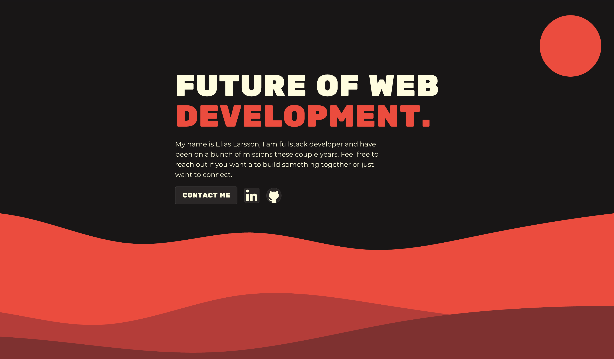

# Elias Larsson — Developer Portfolio

[**Live website**](https://eliaslarsson.dev) · [**LinkedIn**](https://www.linkedin.com/in/elias-h-larsson/) · [**GitHub**](https://github.com/Elias-Larsson)

A personal developer portfolio built to showcase my software engineering work, technical projects, experience, and education. The website combines a custom-designed Next.js frontend with Sanity CMS, making it possible to update project content and professional information without editing the application code.



## Overview

The goal of this project is to present my work beyond a traditional résumé. Each project can have its own page with technical details, media, and links to a repository or live demo. The site also includes a more personal About page and a professional timeline covering experience and education.

## Features

- **Featured projects:** Selected projects are highlighted on the homepage.
- **Project case studies:** Dedicated routes for individual projects, with descriptions, technologies, images or video, and optional demo/repository links.
- **Experience and education:** A work grid with individual case studies and a separate education section, populated from Sanity.
- **About page:** An editorial layout with profile media and configurable story sections.
- **Content management:** An embedded Sanity Studio at `/studio` for editing site content.
- **Custom visual design:** Responsive layouts, large typography, animated transitions, parallax effects, and smooth scrolling.
- **SEO basics:** Page metadata, an Open Graph preview image, `robots.txt` configuration, and a sitemap route.
- **Accessibility considerations:** Reduced-motion preferences are respected by selected animations and smooth-scrolling behavior.

## Tech Stack

| Area | Technology |
| --- | --- |
| Framework | Next.js 15 (App Router), React 19 |
| Language | TypeScript |
| Styling | Tailwind CSS 4, CSS |
| Content management | Sanity CMS, next-sanity, GROQ |
| Scrolling and animation | Lenis, CSS animations |
| Typography | Rubik One, Montserrat |
| Package manager | Bun |

## Getting Started

### Prerequisites

- A compatible Node.js runtime and [Bun](https://bun.sh/)
- A Sanity project and dataset containing the portfolio content

### 1. Clone the repository

```bash
git clone https://github.com/Elias-Larsson/myportfolio.git
cd myportfolio
```

### 2. Install dependencies

```bash
bun install
```

### 3. Configure environment variables

Create a `.env.local` file in the repository root:

```dotenv
NEXT_PUBLIC_SANITY_PROJECT_ID=your_sanity_project_id
NEXT_PUBLIC_SANITY_DATASET=production
NEXT_PUBLIC_SANITY_API_VERSION=2025-07-11
NEXT_PUBLIC_BASE_URL=http://localhost:3000
```

`NEXT_PUBLIC_SANITY_API_VERSION` is optional; the application has a default value. The other variables are needed to configure the content client and site metadata. Use your own Sanity project ID and dataset. The site's content is stored in Sanity, not in this Git repository, so a fresh project will need content documents before all sections can be populated.

### 4. Start the development server

```bash
bun run dev
```

Visit [http://localhost:3000](http://localhost:3000).

The embedded Sanity Studio is available at [http://localhost:3000/studio](http://localhost:3000/studio), subject to your Sanity project's authentication and access settings.

### Production build

```bash
bun run build
bun run start
```

Production canonical URLs use `https://www.eliaslarsson.dev` from `src/app/site.ts`. `NEXT_PUBLIC_BASE_URL` is a development override. The app permanently redirects the non-`www` and old Vercel hosts to the matching canonical paths. If the hosting dashboard handles a redirect before Next.js receives the request, configure it as a permanent redirect there too.

## Content Management

Sanity is used for the following content types:

- **Homepage** controls the hero, Featured Work heading and intro, About teaser, and footer headline.
- **Projects** controls descriptions, media, technologies, and links. Turn on **Featured on homepage** to include a project there. Turn on **Flagship project** for a wide card. Set **Display order** to position cards of the same size (lower numbers first), and use **Archive section** to group projects.
- **Experience & Education** controls published entries, experience logos, case-study text and media, and the order of entries. Upload a logo under **Company logo** for each experience.
- **About** controls the introduction, profile image, “How I work” section, and story chapters.

The frontend retrieves data through GROQ queries in `src/sanity/lib/queries.tsx`. Sanity schemas are defined in `src/sanity/schemaTypes/`.

## Project Structure

```text
myportfolio/
├── public/                     # Static images, icons, and local fonts
├── src/
│   ├── app/
│   │   ├── about/              # About page
│   │   ├── components/         # Shared UI, project views, and animations
│   │   ├── projects/
│   │   │   ├── [slug]/          # Individual project pages
│   │   │   └── page.tsx        # Projects overview
│   │   ├── studio/             # Embedded Sanity Studio
│   │   ├── layout.tsx          # Global layout and metadata
│   │   └── page.tsx            # Homepage
│   └── sanity/
│       ├── lib/                # Sanity client, image helpers, GROQ queries
│       ├── schemaTypes/        # CMS document schemas
│       └── types/              # TypeScript content types
├── sanity.config.ts
├── next.config.ts
└── package.json
```

## Design

The site uses a dark, high-contrast visual identity with cream-colored text and red accents. Large Rubik One headings, Montserrat body text, layered vector backgrounds, and subtle motion give the portfolio a distinct look without relying on a generic template.

## Notes

- Some pages depend on content from the configured Sanity dataset.
- This is a personal portfolio, not a reusable starter template. Deployment requires configuring a Sanity project and environment variables.
- No license file is currently included in this repository.

## Contact

- **Website:** [eliaslarsson.dev](https://eliaslarsson.dev)
- **LinkedIn:** [linkedin.com/in/elias-h-larsson](https://www.linkedin.com/in/elias-h-larsson/)
- **GitHub:** [github.com/Elias-Larsson](https://github.com/Elias-Larsson)

---

Built and maintained by **Elias Larsson**.
